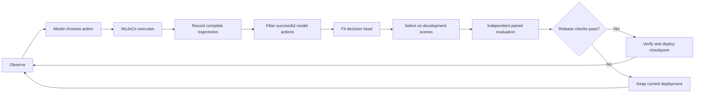

# Embodied RSI Lab

**A unified workbench for robot simulation, model decisions, and self-evolving training.**

[中文说明](README.zh-CN.md) · [Documentation](docs/README.md) · [Installation](docs/INSTALLATION.md) · [Architecture](docs/ARCHITECTURE.md) · [Learning & reproduction](docs/LEARNING_GUIDE.md)

Embodied RSI Lab connects model decisions to a Franka Panda arm in MuJoCo, records what actually happens, and learns from successful trajectories. A candidate model becomes the deployed model only after independent evaluation passes the release checks.

The project integrates [embodied-jev](https://github.com/FBddcz/embodied-jev), which supplies model adapters, perception, action protocols, and physics, with [embodied-rsi](https://github.com/gaohuan2020/embodied-rsi), which supplies collection, filtering, training, evaluation, and deployment. The Python package names preserve those responsibilities. **One service serves the entire application at `/simulation`.**

## What you can do

| Workspace | Purpose |
| --- | --- |
| Model configuration | Manage local endpoints, remote APIs, named model profiles, presets, and connection tests. |
| Model test | Inspect observations, model requests, candidate choices, physical actions, camera views, and replay. |
| Model comparison | Run sequential comparisons with the same task and configuration; inspect and export results. |
| Self-Evolving Training | Collect trajectories, filter data, fit the decision head, evaluate candidates, and inspect deployments. The full training report is part of this workspace. |
| Docs | Read bilingual explanations, interactive architecture diagrams, source maps, and setup instructions. |

The UI defaults to **English**, with **中文** available in the top navigation. Process logs cover perception, decisions, filtering, training, evaluation, and deployment; detailed records remain available alongside summaries.

## How the learning loop works



**Lower training loss is not sufficient for deployment.** The evaluator compares candidate and reference on matched, held-out scenes and checks success gains and risk metrics. Collection success, development performance, and release evaluation are different measurements.

The default task is **transfer into a tray**. Stack and barrier tasks are available in the underlying simulator and experimental tools; a transfer-only result does not establish performance on those tasks or on real hardware.

## Install and start

Run these commands on your experiment host. This project uses a dedicated DGX Spark host for experiments; deployment-specific credentials and addresses are absent from this repository.

Prerequisites: Git, `uv`, **Python 3.12**, and **Node.js 22.12+**. Linux headless rendering also needs an OpenGL backend; see the [installation guide](docs/INSTALLATION.md).

```bash
git clone https://github.com/InfronAI/Embodied-RSI-Lab.git
cd Embodied-RSI-Lab

# Python backend and pinned upstream source
uv python install 3.12
uv venv --python 3.12 .venv
.venv/bin/python scripts/bootstrap.py

# Web UI dependencies and production assets
npm ci
npm run build

# Private runtime configuration
cp lab-config.example.json lab-config.json
.venv/bin/embodied-lab serve
```

Open **http://127.0.0.1:8092/simulation** on the experiment host, or use your authenticated HTTPS deployment. The Python service serves the built frontend; a separate Vite server is not needed in production. Vite development mode only previews the model workbench.

The base environment supports physics and remote model APIs. **RSI inference and training require a separate environment**:

```bash
uv venv --python 3.12 .venv-rsi
.venv/bin/python scripts/bootstrap.py --rsi
```

For the GB10 / CUDA 13 configuration, use the additional constraints and OSMesa instructions in [DGX Spark deployment](deploy/spark/README.md). Model weights download separately; neither model caches nor private experiment data are included in Git.

## Models and observations

| Capability | Model test / comparison | Self-Evolving Training |
| --- | --- | --- |
| Remote structured / chat APIs | Supported through the corresponding adapter | Not a trainable backend for this loop |
| Local RSI checkpoint | Through its decision endpoint | Training and deployment backend |
| Skills, incremental XYZ, hierarchical XYZ | Subject to model/observation compatibility | Saved with trajectories and checkpoints |
| Simulator state / RGB-D | Supported | Supported |
| Direct image input | Compatible visual API adapters | Disabled for the current text/structured RSI checkpoint |

RGB-D requires at least one model camera. A detection failure does not silently substitute simulator truth. The central debug camera is separate from observations passed to the model. See [configuration](docs/CONFIGURATION.md) for exact settings and credential behavior.

## Repository map

```text
src/embodied_lab/       Unified launcher
src/embodied_jev/       Physics, perception, action protocols, model adapters
src/embodied_rsi/       Collection, training, evaluation, deployment, main UI
frontend/              Model workbench frontend and integration entry
scripts/               Bootstrap, verification, reproduction, optional benchmarks
tests/                 Python tests for both integrated packages
tests-lab-ui/           Unified workbench and documentation browser tests
tests-ui/              Model workbench browser tests
docs/                  Current guides, upstream references, historical results
deploy/spark/          Generic DGX Spark templates and GPU checks
upstreams.lock.json    Pinned upstream repositories and commits
```

Generated assets, environments, credentials, runtime databases, checkpoints, and migration backups are excluded. Copy the configuration examples and customize the ignored files for your host.

## Where to go next

1. [Install the backend, Web UI, and optional RSI environment](docs/INSTALLATION.md).
2. [Follow one decision through the code, then reproduce a learning cycle](docs/LEARNING_GUIDE.md).
3. [Read business, system, and data-flow diagrams](docs/ARCHITECTURE.md).
4. [Configure models, observations, logging, and data paths](docs/CONFIGURATION.md).
5. [Deploy on DGX Spark and manage the service](deploy/spark/README.md).
6. [Contribute and validate changes](CONTRIBUTING.md); [review publication and secret handling](SECURITY.md).

Historical documents and recorded benchmarks are reference evidence, not promised performance for a fresh installation. Preserve model revisions, execution settings, scene seeds, and dataset provenance when comparing results.

## License and origins

MIT; see [LICENSE](LICENSE). Original copyright notices are retained. Panda assets retain their Apache-2.0 license. Separately downloaded RSI-Jev source and model weights keep their own terms; see [third-party notices](THIRD_PARTY_NOTICES.md) and [pinned upstreams](upstreams.lock.json).
