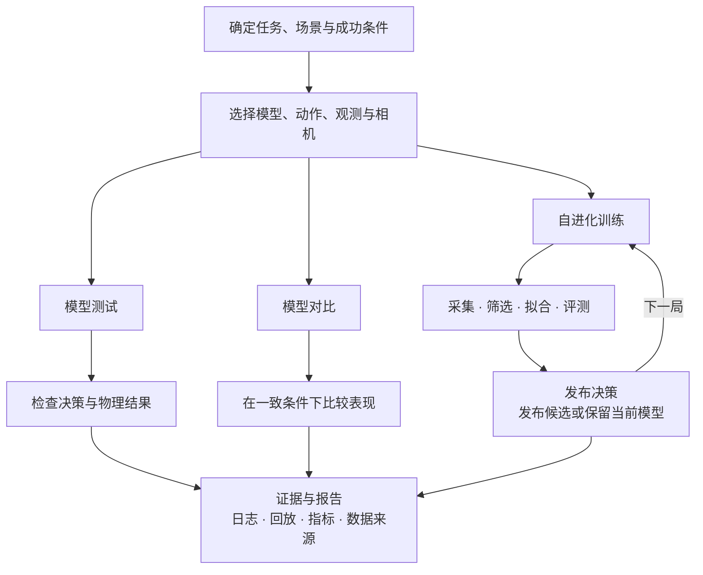
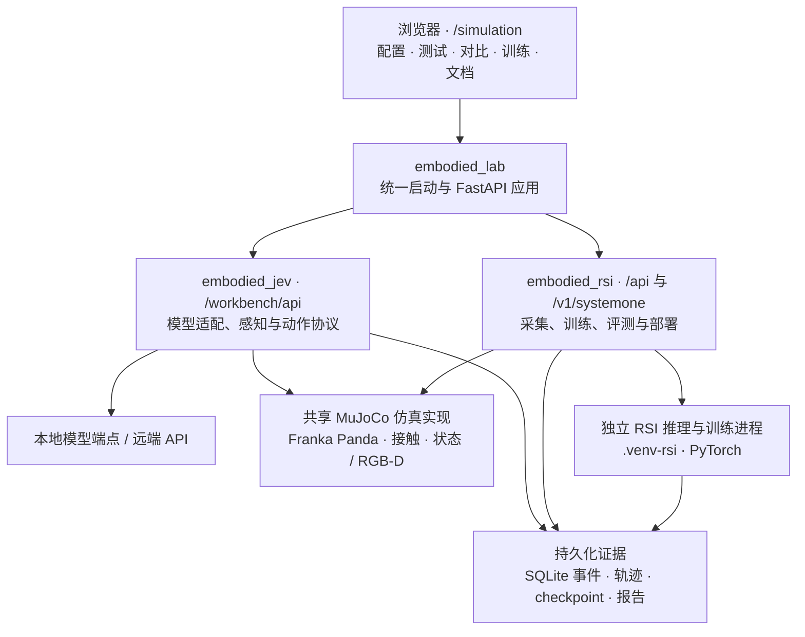
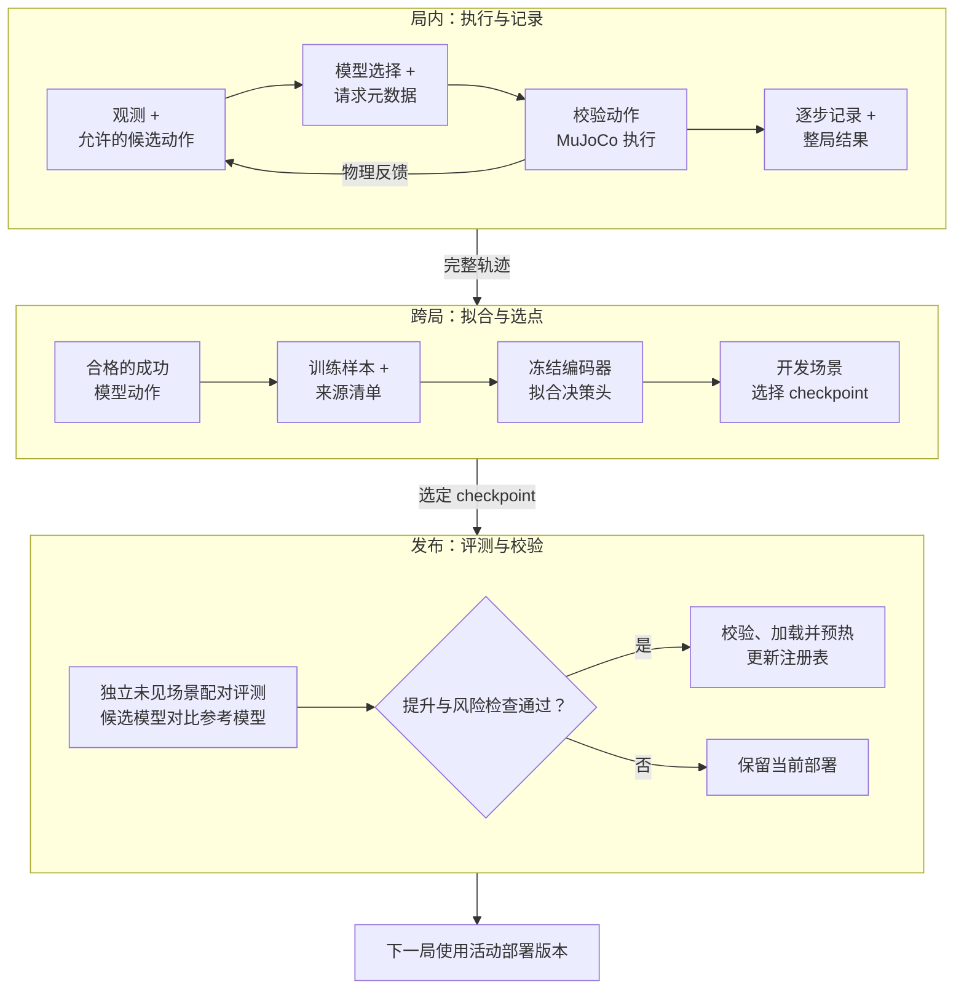

# Embodied RSI Lab

**统一的机械臂仿真、模型决策与自进化训练工作台。**

[English](README.md) · [文档索引](docs/README.md) · [安装运行](docs/INSTALLATION.md) · [架构与数据流程](docs/ARCHITECTURE.md) · [学习与复现](docs/LEARNING_GUIDE.md)

https://github.com/user-attachments/assets/9df6190c-4ce5-40e0-a28b-4c5be9e95cf5

**自进化训练速览 · 30 秒加速回放。** 连续展示机械臂动作与同步决策、轨迹筛选、100 步真实优化，以及 loss、单步与累计权重变化曲线、checkpoint 选择和独立评测。素材来自不同采集与训练批次的真实实验记录。[下载 MP4](docs/media/self-evolving-training.mp4) · [视频说明](docs/media/self-evolving-training.json) · [原始数据](docs/media/self-evolving-training-data.json)。

模型读取观测并选择动作，MuJoCo 执行物理仿真，系统记录完整轨迹，从成功经验中拟合决策头。候选模型通过独立评测后才会部署，继续下一轮探索。

**选择动作、执行动作、完成任务是三件事。** 闭爪可能空抓，物体到达目标盘也可能尚未稳定。工作台串联模型输入、物理反馈和最终结果，让研究者能解释失败，并判断训练是否提高了任务完成率。

本项目融合两个开源项目：[embodied-jev](https://github.com/FBddcz/embodied-jev) 提供模型接口、感知、动作协议和物理实验；[embodied-rsi](https://github.com/gaohuan2020/embodied-rsi) 提供轨迹采集、筛选、训练、评测和部署。`embodied_lab` 是统一入口。保留 Python 包名以区分职责，**运行时只需一个服务，所有功能位于 `/simulation`**。

## 工作台功能

| 页面 | 可以做什么 |
| --- | --- |
| 模型配置 | 管理本地端点、远端 API、具名模型、任务预设和连接测试。 |
| 模型测试 | 查看观测、模型请求、候选选择、动作执行、相机画面和回放。 |
| 模型对比 | 在一致的任务与配置下顺序比较模型，查看并导出结果。 |
| 自进化训练 | 采集、筛选、拟合、独立评测和部署；完整训练报告位于本页下方。 |
| Doc 文档 | 中英文原理说明、交互架构图、源码导读、安装和复现指南。 |

默认英文，顶部可切换中文。过程日志覆盖**感知、决策、轨迹过滤、拟合训练、评测与部署**，支持查看原始记录。

## 核心概念

**两个闭环，共用一条证据链：**

- **局内循环：** 观测、决策、执行，再读取物理反馈。一局内固定模型版本；探索调整动作的采样方式。
- **跨局循环：** 筛选经验、拟合候选、评测，再决定是否部署。训练更新权重；新发布的模型从下一局开始生效。

默认方法是**按结果筛选的自模仿学习**：完整成功局中符合条件的模型动作成为训练目标，编码器保持冻结，仅训练决策头。失败轨迹仍保留，用于诊断和探索。

## 从业务到系统，再到数据

### 1. 业务流程图：研究者如何开展实验

**实验条件 = 模型 + 任务 + 场景 + 执行配置。** 模型测试解释单个模型的行为；模型对比在一致条件下衡量差异；自进化训练产生并评测新的本地 checkpoint。



### 2. 系统架构图：各模块如何分工

浏览器访问同一个 Python 服务。**`embodied_lab` 统一启动，`embodied_jev` 负责模型交互与物理执行，`embodied_rsi` 管理学习与部署。** 模型工作进程使用独立的 Python 环境。



各工作区复用物理与动作实现，实验会话保持独立。远端 API 可用于模型测试和对比；当前训练闭环更新**本地 RSI 决策头**。

### 3. 数据流程图：经验如何变成可部署模型

观测与决策经过物理执行形成证据。符合条件的成功动作进入模仿训练，开发场景选出 checkpoint，再由**独立未见场景判断是否发布**。



**训练损失下降不足以决定发布。** 评测在相同的独立场景上比较候选模型与参考模型，检查完成率提升及风险。采集成功率、开发成绩和独立评测结果各自衡量不同阶段。

复现时保留运行与局 ID、模型哈希、场景种子、执行配置和数据来源。详细接口与发布校验见[架构文档](docs/ARCHITECTURE.md)；启动后打开 `/simulation#docs`，可阅读交互图和分步讲解。

默认任务为**搬运入盘**，研究范围是受约束的桌面仿真。任务、候选动作和部分几何辅助由程序定义。堆叠和越障存在于底层仿真及实验工具中；单任务成绩不能证明其他任务或真机表现。

## 安装和启动

以下命令在**实验服务器**执行。项目实验默认使用专用 DGX Spark；仓库不包含实际服务器地址、账号或凭证。

准备 Git、uv、Python 3.12 和 Node.js 22.12+。无桌面的 Linux 需要配置离屏渲染，详见[安装指南](docs/INSTALLATION.md)。

```bash
git clone https://github.com/InfronAI/Embodied-RSI-Lab.git
cd Embodied-RSI-Lab

# 后端
uv python install 3.12
uv venv --python 3.12 .venv
.venv/bin/python scripts/bootstrap.py

# Web UI
npm ci
npm run build

# 私有运行配置：复制后修改，不提交到 Git
cp lab-config.example.json lab-config.json
.venv/bin/embodied-lab serve
```

在实验主机打开 **http://127.0.0.1:8092/simulation**，或通过自行配置的 HTTPS 入口访问。生产环境由 Python 提供构建后的前端，无需同时运行 Vite。

基础环境可进行物理仿真和远端 API 测试。RSI 推理与训练另装隔离环境：

```bash
uv venv --python 3.12 .venv-rsi
.venv/bin/python scripts/bootstrap.py --rsi
```

GB10 / CUDA 13 主机请使用 [DGX Spark 部署指南](deploy/spark/README.md) 中的额外依赖约束和 OSMesa 渲染配置。模型权重另行下载，不随 Git 发布。

## 配置边界

模型测试与对比支持对应适配器下的远端 Jev、结构化决策、Chat 和 Claude API。**自进化训练使用可训练的本地 RSI checkpoint**，当前不通过远端聊天 API 训练模型。

训练支持预设技能、逐步 XYZ、分层 XYZ，以及仿真真值或 RGB-D。RGB-D 至少启用一个模型相机；检测失败不会回退到仿真真值。当前 RSI 是文本／结构化决策模型，因此直接图像输入明确禁用。中央调试视角不代表模型获得了该画面。

API 密钥使用运行主机的凭证存储；无可用凭证存储时，页面会说明仅在进程会话中保留。部署时也可通过受保护的环境变量配置。详见[配置与数据管理](docs/CONFIGURATION.md)。

## 代码与学习顺序

| 目录 | 职责 |
| --- | --- |
| `src/embodied_lab/` | 统一启动与配置加载 |
| `src/embodied_jev/` | 物理、感知、动作协议、模型适配器和测试 |
| `src/embodied_rsi/` | 采集、训练、评测、部署、主界面和报告 |
| `frontend/` | 模型工作台前端 |
| `scripts/` | 安装、验证、复现与可选基准工具 |
| `tests/`、`tests-*-ui/` | 后端与浏览器测试 |
| `docs/` | 当前指南、上游资料与历史结果 |
| `deploy/spark/` | 通用部署模板与 GPU 验证脚本 |

先在模型测试中观察一个动作，再读模型协议与物理执行；接着跟踪完整轨迹如何被过滤和拟合；最后阅读开发选点、独立评测和原子部署。命令及对应源码见[学习与复现](docs/LEARNING_GUIDE.md)。

历史文件只代表当时记录的配置和结果。复现时使用新实验目录，保留模型 revision、种子、动作协议、相机和数据来源。

## 文档与许可

- [全部文档](docs/README.md)、[业务／系统／数据架构](docs/ARCHITECTURE.md)
- [开发与验证](CONTRIBUTING.md)、[敏感信息与发布规范](SECURITY.md)
- [MIT 许可证](LICENSE)、[第三方声明](THIRD_PARTY_NOTICES.md)

仓库保留上游版权声明。Panda 资产使用其原有 Apache-2.0 许可证；独立下载的 RSI-Jev 与模型权重遵循各自许可。
