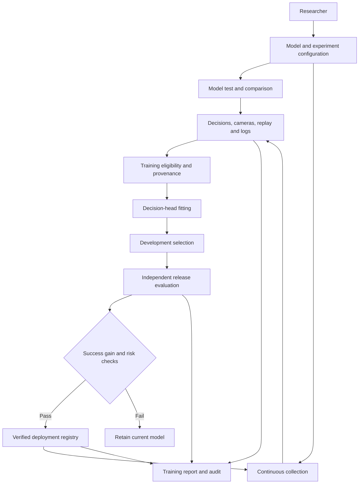
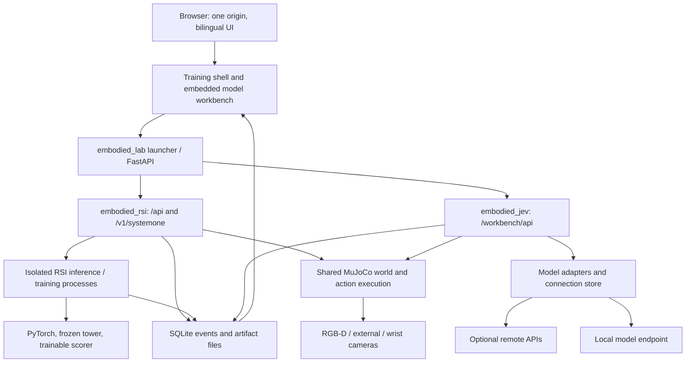
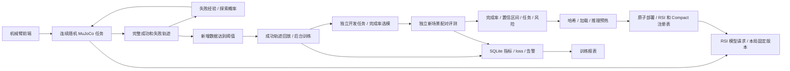

# Architecture and decision flow / 架构与决策

The application has two connected loops: **interactive decisions** execute and explain one action; **self-evolving training** converts valid experience into a candidate, then tests whether that candidate deserves deployment. The simulator determines physical outcomes; the model chooses among the actions permitted by its protocol.

## Business architecture / 业务架构



The operator configures observations, cameras, action mode, thresholds, and a local trainable checkpoint. Remote model APIs serve testing/comparison. Collection and training have separate controls: stopping new trajectories does not terminate a job already fitting or evaluating a candidate.

## System architecture / 系统架构



`embodied_lab` resolves configuration and launches the integrated dashboard. The model workbench is mounted in the same process, not reached through a second application server. GPU inference/training uses the separate `.venv-rsi` interpreter, allowing simulator and model dependency sets to differ. An authenticated reverse proxy provides the access boundary for a public deployment.

## Data flow / 数据流程

```mermaid
sequenceDiagram
  participant UI as Operator / UI
  participant Sim as Simulator
  participant Model as Model worker
  participant DB as Artifact store
  participant Train as Trainer
  participant Eval as Evaluator
  participant Reg as Registry
  UI->>Sim: Execution settings and episode seed
  Sim->>Model: Allowed observation, history, candidate actions
  Model-->>Sim: Choice, probabilities when supported, latency
  Sim->>Sim: Validate and execute with physics
  Sim->>DB: Decision, action result, sensor metadata
  loop Until success, limit, or cancellation
    Sim->>Model: Next observation and actual feedback
    Model-->>Sim: Next decision
    Sim->>DB: Step and provenance
  end
  Sim->>DB: Complete episode outcome
  DB->>Train: Eligible successful actions and manifest
  Train->>Train: Fit scorer; select on development scenes
  Train->>Eval: Candidate checkpoint and data provenance
  Eval->>DB: Paired held-out results and release checks
  alt Checks pass
    Eval->>Reg: Candidate hash and evaluation
    Reg->>Model: Load and warm candidate
    Reg->>Reg: Atomic registry update
    Reg-->>Sim: New version available for next episode
  else Checks fail
    Eval-->>UI: Reasons; current deployment retained
  end
```

An episode retains one model version. Observations must respect the selected protocol: simulator-state mode exposes specified privileged geometry; RGB-D supplies detector output; current trainable RSI does not accept direct images. Ground-truth success is an outcome, not a future label in the model input.

Trajectory filtering preserves failure evidence while excluding invalid imitation targets. Training uses a dataset manifest and exact checkpoint identity. Development scenes choose a training step; release scenes compare the chosen model against its reference. The registry validates the same checkpoint hash, warms inference, and rejects stale replacement decisions.

The following implementation reference details the current training protocol, modules, persistence, and routes.



## 模块

| 模块 | 职责 |
|---|---|
| `sim.py` | 九技能协议、当前观测白名单、真实物理执行、完整任务回报 |
| `scenes.py` | 位置与障碍高度随机化、可复现种子、均衡随机任务轮换 |
| `code_policy.py` | 当前观测驱动的 transfer 代码策略、有限恢复、代码与模型混合决策 |
| `code_study.py` | 冻结代码／模型对照、空抓故障注入、独立种子、配对统计与来源隔离 |
| `simulation.py` | 连续执行、步数重置、渲染专用线程、暂停／停止／回放、授权意图恢复 |
| `exploration.py` | 当前状态分桶、失败经验持久化、探索概率调整、原始概率保留 |
| `auto_training.py` | 新增完整轨迹和成功数双阈值、等待忙任务、触发水位与恢复 |
| `self_improvement.py` | 成功模型轨迹筛选、特征缓存重放、开发选模、独立发布闭环 |
| `task_rsi.py` | 上游 RSI 冻结塔、可微决策头、缓存回放和整局策略梯度 |
| `task_training.py` | 可选 Compact / RSI 整局 REINFORCE |
| `workflow.py` / `evaluation.py` | 独立种子分配、配对报告、发布门槛、评测哈希绑定 |
| `deployment.py` / `inference_worker.py` | 注册表、实际加载与预热、版本引用、隔离 RSI JSON-lines 请求 |
| `dashboard.py` / `web/` | 模拟与训练报表、受限后台作业、原始样本浏览、推理 API |
| `storage.py` / `monitor.py` | SQLite WAL、指标与资源事件、异常检测 |

## 数据与训练目标

MuJoCo 根据物体位置、稳定支撑、释放与撤离判定整局成功。模型输入仅包含当前物体／目标／末端坐标、本体与接触状态、近期动作结果，不包含成功真值、种子、教师动作或未来收益。默认使用 privileged-state 技能选择，程序提供航点、IK 和碰撞预演。自主训练也支持逐步 XYZ、分层 XYZ 与 RGB-D 检测坐标；执行配置经 `execution.py` 验证，由 `configured_sim.py` 接到共享物理执行，随数据与 checkpoint 保存并在评测中复用。当前本地 RSI 不接受直接图像。

默认自我提升只训练完整成功模型轨迹中的实际执行动作。失败轨迹保留；成功轨迹内被拒、空抓、失抓和未夹持搬运动作也不作为模仿目标。训练 loss 是回放交叉熵，**开发完整任务完成率才决定保存哪一步**。教师初始化通过单独 `initialize` 实验记录，不计作模型自采成功。

`code-study` 独立比较代码策略、关闭恢复的消融策略、RSI 与混合策略。所有策略使用同初态、同阶段配置和严格抓取成功定义。实验记录标记为 `evaluation_only`，成功回放入口拒绝导入；代码与混合来源也不能标记为模型自主成功。代码实验只出具报告，不触发部署。协议及使用方式见 [代码策略实验](CODE_POLICY.md)。

失败探索使用状态桶的动作经验，结合模型原始概率、温度、新动作奖励、失败惩罚与 5% 均匀探索。该策略不会直接修改模型权重。正式评测不附加探索记忆，比较模型确定性决策。

当前默认仅 transfer，每新增 30 局且其中至少 5 局成功后训练；必须同时满足两个阈值。后台忙时继续收集并等待，接受训练后推进消费水位，避免同一小批成功反复触发。连续采集保存当前模型版本，每局终点后检查部署变化；停止只终止采集，训练页可单独停止后台训练。训练 CLI 使用持久文件锁，服务重启后也不会同时更新两个模型。

## 场景隔离和泛化

`workspace-random-v1`：源 X/Y 以 (0.43, -0.17) 米为中心分别 ±3.5/3 厘米；目标以 (0.43, 0.18) 为中心分别 ±2.5/2 厘米；越障高度 8–12 厘米。每个种子可复现。三种任务在每个连续三局区块中打乱顺序，均衡覆盖。上游参数验证、关键位姿可达性和实际碰撞检查仍运行。

此随机目标分布保留为后续泛化扩展。当前 transfer-study 采用原始 ±2.5cm 源位置扰动、固定目标，采集、开发和发布使用互不重叠的种子。每轮事务预留 30,000 个种子，训练／开发／发布各 10,000；取消的区间不再重复分配。发布也检查实际成功数据 manifest 的场景组，不把历史回放场景当作未见评测。每份报告记录场景分布，不把不同分布的多个评测当成相同测试集的连续成绩。

## 模型部署和恢复

加载不可变检查点，核对评测 SHA256、实际推理预热，再次核对文件；写锁下比较当前注册表与评测对手，拒绝过期切换。`champion-rsi.json` 与 `champion-compact.json` 分别保存，`champion.json` 为当前活动接口版本。

RSI 自动更新在尚无已发布 RSI 时请求固定 revision 的初始模型；也可从用户选择的检查点开始。通过评测后下一局使用新注册版本。一局内不换模型，旧 GPU worker 在所有引用释放后清理。渲染是 MuJoCo 实际画面，模型不生成仿真图像。

`live-session.json` 保存连续执行意图、下一局种子和训练水位；服务重启只恢复仍标记 active 的授权会话。停止／重置显式清除此意图。中断半局单独保存，不混入完成率或成功训练数据。

## 页面与 API

| 路由 | 功能 |
|---|---|
| `GET /` | 重定向至统一工作台 `/simulation` |
| `GET /training` | 重定向至自主训练下方的完整报告 `/simulation#report` |
| `GET /simulation` | 统一导航、实际物理画面、连续采集、训练与报告；模型配置、测试、对比和 Doc 通过 hash 切换 |
| `/simulation#docs` | 中英文技术原理、代码导读、安装与复现文档 |
| `/workbench/api/` | 同一进程挂载的模型连接、测试、视觉和对比接口 |
| `GET /api/overview` | 实验、资源、数据集、后台作业与部署版本 |
| `GET /api/runs/{id}/events?after=seq` | 增量持久事件 |
| `GET /api/datasets/{id}/samples?offset&limit` | 实际训练样本及来源 |
| `GET /api/runs/{id}/episodes?outcome&offset&limit` | 完整成功／失败轨迹，只读取已完成行 |
| `POST /api/jobs` | transfer-study、self-improve、initialize-rsi、cycle、task-train、collect、train、evaluate |
| `POST /api/jobs/{id}/stop` | 停止本实例的后台训练作业 |
| `GET /api/simulation` | 渲染、观测、动作、累计结果和自动训练状态 |
| `POST /api/simulation/control` | run、pause、resume、step、reset、stop、camera |
| `GET /api/simulation/replay/{index}` | 当前会话最多 1,000 帧 |
| `POST /v1/systemone` | 当前活动部署模型，返回实际 model_version |

停止按钮仅发送 `{"action":"stop"}`，不依赖其他表单值；后端不要求停止验证检查点。取消设置物理线程事件并清除下一局意图，取消后的半局不产生虚假成功。

工作台默认是单用户 loopback 工具，验证 Host 和跨 Origin 写请求。公开部署通过 `EMBODIED_LAB_PUBLIC_ORIGIN` 允许精确的外部 origin，并在反向代理层认证。页面关闭不影响后台训练；服务重启可读持久记录，但不接管旧实例的作业控制句柄。

## 单任务受控研究

transfer_study.py 在开始冻结协议和单独预留审计种子，进行多轮采集、成功回放与 90 对单任务发布；全部训练结束后才审计 V0 和每个候选。报告分别判断候选与实际部署版本是否严格递增，未发布时部署曲线保留上一版本。发布报告和注册表声明实际覆盖的任务，transfer 成绩不证明其他两种任务。
